  

  Welcome to <b>Huizinga F.C.</b>, a club of about 25 AI agents and one manager who still does the in-home visits. 
  We play a patient passing game: every customer message goes through the keeper before it leaves the ground.

## The gaffer

<table>
  <tr><th align="left">Manager</th><td>Gerrit Huizinga, player-manager</td></tr>
  <tr><th align="left">Appointed</th><td>April 2025, as AI Lead at Zinga's</td></tr>
  <tr><th align="left">Home ground</th><td>Indianapolis, Indiana. Happy to play away (remote)</td></tr>
  <tr><th align="left">Came up through</th><td>In-home sales, marketing, and coaching youth soccer</td></tr>
  <tr><th align="left">Philosophy</th><td>Nothing leaves the pitch without the manager's nod</td></tr>
  <tr><th align="left">Backroom staff</th><td>Claude Code writes the code. I pick the team, run the drills, ship it, and take the blame</td></tr>
</table>

## Team sheet

  

<b>Scouting report</b> (who these players are off the pitch)

 

| # | Player | Day job |
| :-: | :-- | :-- |
| 1 | **Send Gate** | Every customer text passes this one gate: a person approves it, or it waits out a 5-minute Stop window |
| 2 | **DNC Check** | Blocks do-not-contact numbers. If the list can't be reached, nothing sends |
| 5 | **Hours 8–8** | Holds any text outside 8 AM to 8 PM |
| 4 | **No Prices** | Never auto-sends anything about prices, complaints or cancellations |
| 3 | **Watchdog** | Texts the manager if the assistant goes down, with a heartbeat monitor, activity log and backups behind it |
| 10 | **Val** (captain) | Always-on AI assistant: reads email and the business line, drafts replies in the owner's voice, remembers 170 meetings |
| 8 | **Zinga's OS** | The company web app (Next.js, TypeScript, Supabase, Vercel) with a control room where every draft is approved, edited or skipped |
| 6 | **Salesforce** | The link to Salesforce, Google sign-in and calendar |
| 7 | **Daily Briefs** | Morning and evening briefs |
| 9 | **Follow-ups** | Staged follow-ups at 48 hours, 7 days, then day 14 to 90, capped at 25 a day |
| 11 | **Estimator** | Customer proposal link and PDF, pricing, upgrades, discounts and deposits |

## Latest scores

  

## Season stats

  

**Official kit suppliers:** Python · TypeScript · Next.js · Supabase · Vercel · Claude Code

## Club news

  

## The season so far

  <picture>
    <source media="(prefers-color-scheme: dark)" srcset="https://raw.githubusercontent.com/gghuizinga23/gghuizinga23/output/season-dark.svg" />
    
  </picture>

The ball working its way through the season, one matchday at a time.

## Transfer news

The manager is **open to offers**: AI solutions, deployment and implementation roles, in Indianapolis or remote.

Contact his agent (it's him): **[LinkedIn](https://www.linkedin.com/in/gerrithuizinga)** · **[X](https://x.com/gerrith777)** · **[YouTube](https://www.youtube.com/@gerrithuizinga)**

Club facilities are private. Stadium tours (code walkthroughs) on request. No agents were sent on without approval in the making of this page.

